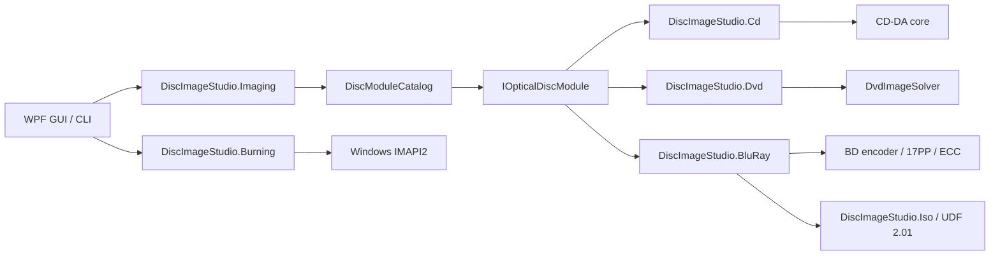

# Описание архитектуры

## Цели

Основная цель — сделать оболочку приложения независимой от конкретного способа кодирования оптических дисков. Физическая модуляция, коррекция ошибок, организация секторов и файловые системы у CD, DVD и Blu-ray различаются, поэтому общими являются жизненный цикл задач и продуктовые возможности, а не ошибочный базовый класс «универсального кодировщика».

## Контракты Core

`DiscImageStudio.Core` не ссылается на WPF, CD, DVD или какой-либо конкретный кодировщик и нацелен на `net10.0`.

- `IOpticalDiscModule`: граница выполнения модуля.
- `DiscModuleDescriptor`: ID модуля, семейство носителей, возможность отмены и метаданные команд.
- `DiscCommandDescriptor`: команды, возможности и определения параметров, пригодные для будущей динамической генерации интерфейса.
- `DiscJobRequest`: единый носитель команды и параметров.
- `DiscJobProgress`: независимый от носителя прогресс, этап, объём выполнения и затраченное время.
- `DiscJobResult`: код выхода, сводка и пути вывода.
- `DiscModuleCatalog`: маршрутизация команд, проверка дублирующихся команд и выполнение модулей.
- `ToneProfile` / `ToneDither`: общая для CD/DVD/BD модель тона (интенсивность дизеринга, уровни градаций серого, яркость, линеаризация sRGB) и детерминированная фаза дизеринга. CD/DVD выполняют дизеринг по индексу логического байта, поэтому после отложенного чередования CD его всё ещё можно воспроизвести в предпросмотре; BD однократно квантует в разрешении исходного изображения, и генерация, запись и предпросмотр используют одну и ту же двоичную растровую карту.

Все три значения `OpticalDiscFamily` (`CompactDisc`/`Dvd`/`BluRay`) уже реализованы; проект, пресеты, дизайн, предпросмотр, экспорт, запись и калибровка ветвятся по этим трём типам дисков.

Пресеты дисков хранятся в едином `disc-presets.json` Core (schema 4): три группы `cdPresets`, `dvdPresets`, `bluRayPresets`, каждая со своим списком отключённых элементов. При чтении старых файлов schema 2/3 добавляются встроенные шаблоны BD, а при следующем сохранении выполняется обновление.

## Модель проекта и оболочка

`DiscImageStudio.Core.ProjectJsonStore` хранит `.discproj` (UTF-8 JSON, schemaVersion 2): имя проекта, тип диска (CD/DVD/BD), геометрию (CD r0/r1/секторы; для DVD добавляются три коэффициента шага дорожек; BD требует выравнивания по 32 секторам, однослойной ёмкости и ≤60 мм), список слоёв, конфигурацию вывода, необязательный раздел тона `tone`, необязательный раздел полярности `bluRay`, путь к записи калибровки и эскиз, отрисовываемый при сохранении. Отсутствие `tone` означает старый жёсткий порог; файлы CD/DVD schemaVersion 1 после чтения автоматически записываются обратно как 2. `bluRay.invertMapping` BD существует только в проектах BD; CD/DVD с этим разделом отклоняется. Чтение и запись проходят проверку и используют атомарную замену через временный файл; правила совпадают с JSON пресетов. Слои ссылаются на изображения по абсолютным путям, ресурсы не собираются.

Оболочка — это модель рабочих областей: стартовая страница (без боковой панели, с созданием/открытием, карточками шаблонов и последними проектами) плюс пять рабочих областей проекта — дизайн / предпросмотр / экспорт / запись / калибровка (перечисление `Workspace`, порядок боковой панели соответствует порядку рабочего процесса). Каждая рабочая область — это представление одного и того же проекта, а не отдельный независимый процесс: они используют общий `DiscParametersState`; при открытии проекта `ProjectSession` заполняет его содержимым документа, а при сохранении захватывает обратно в документ; поэтому привязки предпросмотра, экспорта, записи и калибровки к State полностью развязаны с жизненным циклом проекта. Флаг изменений отслеживает только свойства State, которые записываются в файл проекта.

Пользовательский chrome главного окна ограничивается `WindowWorkArea`: он в `WM_GETMINMAXINFO` устанавливает максимальные позицию/размер по физической рабочей области текущего монитора (включая панель задач, мониторы с отрицательными координатами и разные DPI) и пересчитывает минимальный размер при перемещении окна между экранами, изменении разрешения или DPI; больше не зависит от системных отступов основного экрана `SystemParameters.WindowResizeBorderThickness`.

Видимость рабочего процесса обеспечивается двумя средствами оболочки: **полосой этапов** (`StageBar`) под строкой заголовка страницы (`PageHeader`) — Дизайн → Предпросмотр → Экспорт → Запись │ Калибровка, где текущий этап выделен фирменным синим, пройденные этапы с галочкой и ослаблены, а любой этап можно нажать для прямого перехода, — и кнопкой «Далее» в правом слоте заголовка страницы. Оба подключаются окном к `NavigateTo`: окно хранит все экземпляры страниц и при изменении рабочей области передаёт `CurrentWorkspace` полосам этапов каждой страницы, поэтому рабочий процесс виден и доступен на каждой странице и не зависит от боковой панели.

Скелет и язык панелей страниц рабочих областей являются общими: `MonitorCard` (карточка монитора: иконка в заголовке + заголовок + подзаголовок + слот действий, основное содержимое, необязательная нижняя строка состояния) несёт результаты предпросмотра и сцену фотографий калибровки; `StepCard` (нумерованная карточка шага: бейдж состояния Не начато/Выполняется/Завершено + сворачиваемое основное содержимое) несёт трёхшаговый инспектор страницы калибровки, где активный шаг развёрнут, а остальные свёрнуты; `VisibilityGate` (показывает/скрывает содержимое по булеву значению) унифицирует ветвления по типу диска/режиму на всех страницах, заменив приватные стили `DataTrigger` в отдельных представлениях; `PathField` и `SourceChip` сводят повторяющиеся строки путей и полосы источника к единой реализации; `EmptyStateCard` (иконка + одна фраза + действие перехода) унифицирует пустые состояния на всех страницах. Заголовки карточек бывают двух видов: для контейнеров мониторинга/списков используется цветная полоса заголовка `CardHeaderBandStyle` (MonitorCard, карточка слоёв на странице дизайна), карточки форм сохраняют плоский заголовок; в обоих случаях иконка 15px. Слот `Actions` у `SourceChip` содержит кнопку «Перейти к владельцу», поэтому строка «сводка только для чтения + переход» выглядит одинаково на всех страницах. Правила плотности: боковые панели/панели инспектора всегда используют семейство Compact (36 px), основная сцена и основные кнопки действий — стандартную высоту (44 px), ширина боковых панелей унифицирована токеном `SidePanelWidth` (280).

Боковая панель имеет иконку у каждого пункта рабочей области; при сворачивании до 72 px она становится панелью иконок (заголовки групп скрываются в узком состоянии, подпункты перечисляются напрямую); больше нет сворачиваемых списков иконок, требующих второго щелчка для раскрытия. В правой части заголовка окна находится постоянно присутствующая кнопка «шестерёнка + настройки» (`TitleBar.ShowSettingsButton` + `SettingsRequested`); на главной странице и во всех рабочих областях настройки открываются одним нажатием; заголовок окна выделяет отдельный столбец кнопок, длинное имя проекта автоматически сокращается. Меню приложения «…» слева от кнопки сворачивания содержит только «О программе…» (`TitleBar.ShowAppMenu` + `AppMenuRequested`); Ctrl+, также открывает настройки напрямую; в диалоге не отображается вход в приложение, а в нижней части боковой панели больше нет пункта «О программе».

`DesignView` и `CalibrationView` переключают компоновку в зависимости от ширины страницы: в широком окне рабочая область закрепляется на высоту видимой области (значение закрепления пересчитывается при изменении размеров видимой области/содержимого внешнего `ScrollViewer`; переходные состояния, такие как нулевая видимая область при первой компоновке или разница в один пиксель из-за округления DPI, не оставят страницу в бессмысленном состоянии прокрутки); в узком окне боковая панель переносится под сцену, страница прокручивается целиком (страница дизайна меняется при ширине страницы < 900, страница калибровки — < 990). В узкой компоновке страница дизайна задаёт холсту фиксированную высоту, чтобы при сжатии трёх колонок холст не становился непригодным. Правая колонка страницы дизайна — две карточки естественной высоты «Свойства + Тон», прокручиваемые собственным `ScrollViewer` правой колонки; при ширине страницы < 900 правая колонка переносится под карточку слоёв и прокручивается вместе со всей страницей. Модуль тона (`TonePanel`) — отдельный `UserControl`; в правой колонке шириной 280 px он использует уменьшенную поверхность диска + одноколоночные элементы управления, а в полноширинной правой колонке после переноса переключается на большую поверхность диска слева и элементы управления справа (у него своя область имён, `x:Name` уровня страницы не проникает внутрь).

Панель параметров страницы предпросмотра предоставляется `PreviewInspectorViewModel`: она проецирует три набора параметров CD, DVD и BD в один и тот же набор строк (`ArtifactPath`, `ArtifactLabel`, `MeasuredInnerRadius`, `PreviewSize`, `SamplesPerSector` …). У типа диска нет переключателя внутри страницы — проекционный предпросмотр строго следует типу диска проекта; при открытии проекта он задаётся `SetDiscType`, а инспектор лишь перенаправляет этот набор строк на текущий тип диска, а не подменяет панель второй копией. Группа только для чтения (сгенерированная геометрия) отображается в виде текста, собранного `DiscParametersState`, и ведёт к владельцу; режим чтения готового диска дополнительно предоставляет переключатель «Обратное чередование», напрямую привязанный к общему `CdInterleave`, чтобы внешние звуковые дорожки (без sidecar) читались с объявленным пользователем способом чередования; у BD нет пункта выборки на сектор. Запись в собственную группу предпросмотра (измеренные радиус и шаг дорожек, точность предпросмотра) попадает в текущий отображаемый тип диска и сворачивается в раскрывающийся блок «Измеренные параметры и точность предпросмотра (дополнительно)». Чтение готового BD автоматически читает одноимённый sidecar и восстанавливает общее число секторов, радиусы, начало и конец рисунка, полярность и тон; внешний ISO без sidecar по-прежнему читается с текущей геометрией проекта.

Проекционный предпросмотр дизайна и чтение готового диска на странице предпросмотра используют общий верхний предел разрешения 8192×8192: для CD/DVD — 256–8192 px, для BD — 64–8192 px; при выходе за диапазон рендеринг выполняется по граничному значению. Размеры по умолчанию по-прежнему CD 1600, DVD 1200, BD 2048 px; пользователь может повысить точность в «Размер экспорта (px)» в дополнительных параметрах. «Экспортировать предпросмотр» сохраняет текущий отрисованный PNG, поэтому использует этот размер.

Принадлежность параметров и постепенное раскрытие:

- **Сгенерированная геометрия** (r0, r1, секторы, три шага дорожек DVD) редактируется только в диалоге настроек проекта. Другие рабочие области показывают сводку только для чтения (`GeometrySummary`) и кнопку прямого перехода «Изменить…», больше не предоставляя собственный редактор.
- **Пресеты дисков** — быстрый вход к сгенерированной геометрии, принадлежащий тому же месту: при создании проекта выбираются через список шаблонов слева (перечисляются все не ручные пресеты в каталоге). Диалог настроек проекта больше не показывает выбор типа диска и пресета — тип диска фиксирован вместе с проектом; в нижней части области параметров есть «Сохранить этот набор параметров как пресет», который добавляет текущие поля в пользовательский JSON пресетов (открывается отдельное окно для подтверждения имени; после сохранения каталог сразу обновляется).
- **Параметры доставки разделены по назначению**: рабочая область экспорта отвечает только за запись файлов (путь вывода, CUE, чередование, ISO/папка данных/метка тома), рабочая область записи — только за запись на диск (записываемое содержимое, устройство записи и скорость). Обе используют одно и то же композитное изображение экспортного качества; материал, проверенный в файле, и есть материал, записываемый на диск; записываемые CD/DVD выводятся из источника (тип диска проекта или тип диска калибровочного шаблона), нет переключателя, который можно перевести на неверную сторону. Сегментированный элемент «Записываемое содержимое» на странице записи — выбор источника уровня страницы (та же модель, что «Проекция дизайна / Чтение готового диска» на странице предпросмотра): при выборе композитного изображения проекта сразу показывается сводка источника; при выборе вспомогательного калибровочного шаблона даётся ссылка на рабочую область калибровки; выбор источника больше не вложен внутрь переключателя назначения.
- **Тон** — параметр генерации, относится к правой колонке рабочей области дизайна: интенсивность дизеринга (0–100%, в новом проекте 75%), линеаризация sRGB (гамма), уровни градаций серого CD (2/4 уровня; DVD/BD фиксированно 2 уровня) и яркость (±64) записываются в раздел `tone` проекта; генерация, потоковая запись, чтение и калибровочная проекция используют один и тот же `ToneProfile`. У BD есть отдельный переключатель полярности 3T/6T; в данных это независимый `bluRay.invertMapping`, не вкладываемый в `ToneProfile`. Предпросмотр поверхности диска в модуле проецирует текущее композитное изображение той же картой отображения и мгновенно обновляется при перетаскивании ползунков; страница экспорта сохраняет только параметры вывода и подсказывает, что тон задаётся на странице дизайна; страница предпросмотра не повторяет редактирование.
- **Параметры, специфичные для предпросмотра** (измеренный радиус, размер экспорта, выборка на сектор), остаются на странице предпросмотра, поскольку это поведение просмотра, а не параметры проекта. При открытии проекта измеренная геометрия сначала следует геометрии проекта, поэтому проекция дизайна по умолчанию нейтральна; отклонение двух наборов геометрии отображается только после ввода измеренных значений пользователем; активно перезаписывает их только процесс калибровки.

Рабочая область дизайна (`DesignViewModel` + `DiscDesignCanvas` + `DesignComposer`) поддерживает стек слоёв: слои хранятся в порядке панели (верхний индекс 0, холст рисуется снизу вверх, что совпадает с порядком композиции), холст рендерится в миллиметровой системе координат с началом в центре диска и поддерживает перетаскивание/масштабирование за углы/ручку поворота; строки слоёв — выбираемый список, двусторонне синхронизированный с холстом и панелью свойств. После 450 мс дебаунса редактирования слоёв `DesignComposer` рендерит квадратное композитное изображение (предпросмотр 2048 px, экспорт 8192 px): центр квадрата — центр диска, длина стороны соответствует 2 × внешнему радиусу холста (для CD фиксированно 57,5 мм, для DVD/BD — сгенерированный внешний радиус). Композитное изображение записывается в путь исходного изображения State и становится общим входом для экспорта и предпросмотра; CLI генерации и конвейер об этом не знают. Оба пути доставки — экспорт и запись — используют композитное изображение 8192 px экспортного качества, поэтому материал, проверенный в предпросмотре, и есть материал, записываемый на диск. Кнопка «Далее» в заголовке страницы проходит через Дизайн → Предпросмотр → Экспорт → Запись; калибровка открывается через боковую панель или ссылку на странице записи.

Язык дизайна сосредоточен в `Themes/Tokens.xaml` (цвета, семантические цвета, скругления, включая `RadiusChip`/`RadiusPanel`/зеркальные дуги заголовка и низа карточек, высоты элементов управления, `SidePanelWidth`, отступы страниц, тени плавающих слоёв, палитра холста) и `Themes/Controls.xaml` (иерархия текста, семейства кнопок, элементы ввода, строки списков, панели раскрытия, предупреждающая карточка `DangerCard`, шаблоны карточек монитора и шагов). Анимации в коде единообразно используют три уровня длительности из `Controls/Motion.cs`; пользовательские холсты единообразно получают цвета и рисуют тело диска через `Controls/DiscTheme.cs` и `Controls/DiscRenderCore.cs`, больше не встраивая собственную палитру. Производные стили на основе неявных стилей в `Controls.xaml` (`BasedOn="{StaticResource {x:Type X}}"`) должны быть записаны после неявного стиля: прямая ссылка вперёд не выдаёт ошибку, а молча откатывается к встроенному стилю Windows, и элемент управления появляется со светлым системным видом. Панели, которые должны нести именованное содержимое страницы (например, `MonitorCard`), делаются шаблонными пользовательскими элементами управления, а не `UserControl`: `UserControl` изолирует содержимое в своей области имён, элементы `x:Name` на странице не компилируются, и хуки снимков и подключение холста поэтому не могут до них добраться.

Переключение темы мгновенное: `Themes/Palette.Light.xaml` перекрывает все ключи цветов и кистей из `Tokens.xaml`, `Services/ThemeResolver` вставляет или удаляет светлый слой в позиции 1 объединённого словаря, и окно не нужно пересоздавать. Поэтому представления должны использовать `DynamicResource` для ключей палитры (`StaticResource` зафиксирует тёмные значения на момент загрузки; `ThemePaletteTests` это перехватит); элементы управления, получающие цвета в коде (`SideNavItem`, `SegmentedControl`, `DiscDesignCanvas`, `CalibrationPhotoCanvas`, `JobDock`, `HelpHint`), подписываются на `ThemeResolver.Changed` и повторно читают токены. Системная тема берётся из `HKCU\...\Themes\Personalize\AppsUseLightTheme`.

Настройки приложения сохраняются `Services/AppSettingsStore` в `%LOCALAPPDATA%\DiscImageStudio\settings.json` (camelCase, строковые перечисления, атомарная замена через временный файл): тема, расположение проектов по умолчанию и расположение кэша. Отсутствующий, повреждённый файл или файл со `schemaVersion` выше текущей версии откатывается к значениям по умолчанию; вручную испорченные пути отбрасываются в `AppSettings.Normalize`; настройки никогда не записываются в `.discproj`. Расположение проектов по умолчанию влияет только на начальный каталог диалога создания проекта; если его нет, используется системный каталог документов. `Services/TempFiles` хранит настраиваемый каталог кэша (`LivePreviewDirectory`); сюда записываются композитные изображения дизайна, эскизы и изображения предпросмотра; переключение влияет только на новые задачи; очистка кэша удаляет по белому списку имён файлов (`design-composite-*`, `design-tone-*`, `design-thumbnail.png`, `cd/dvd/bd-live-*` и их sidecar `.png.json`) и никогда не удаляет каталоги, проекты или экспортированные файлы. Окно настроек до сохранения изменяет только копию; отмена или Esc отбрасывает все правки.

## Слой предварительной обработки изображений

`DiscImageStudio.Imaging` находится между интерфейсом и модулями кодирования носителей и сейчас содержит только `RingImageQuality`: константу официального размера генерации композитного изображения страницы дизайна (8192 px), общую для композиции дизайна, экспорта и чтения/записи. Компоновка изображения на поверхности диска (масштабирование, центрирование, обрезка до кольца содержимого) выполняется `DesignComposer` страницы дизайна на мм-холсте; экспорт/запись/предпросмотр напрямую используют результат композиции, отдельного шага предварительной обработки больше нет.

## Слой потоковой записи

`OpticalBurnRequest.ProduceContent` для CD явно требует беззаголовочный PCM 44,1 kHz, 16 бит, двухканальный little-endian; `ContentLength` учитывает только аудиоданные. Беззаголовочный поток CD-генератора по умолчанию сохраняет старый big-endian вывод; при вызове IMAPI оболочка явно выбирает `CdAudioByteOrder.LittleEndian`; преобразование выполняется на выходе целых секторов после завершения отложенного чередования. Генерация файлов выбирает формат по суффиксу `.wav` / `.raw`: WAV использует те же little-endian аудиоданные и дополнительно записывает 44-байтовый заголовок RIFF и одноимённый WAVE CUE; старый RAW остаётся big-endian. Конструктор RAW-образов Windows на практике сохраняет переданные байты как есть и не отвечает за исправление порядка байтов. Подробнее см. [Примечания о совместимости записи CD](CD_AUDIO_COMPATIBILITY.md).

`DiscImageStudio.Burning` отвечает только за перечисление устройств Windows IMAPI2, проверку носителя, адаптацию COM `IStream`, ограниченный буфер памяти 64 MiB (предзаполняется 32 MiB перед началом записи) и жизненный цикл записи. Автоматическая скорость при фактическом начале записи CD/DVD повторно считывает конфигурацию записи текущего диска и выбирает минимальное значение; ручной выбор сохраняет исходное значение; если устройство не сообщает скорость, используется консервативный запасной вариант интерфейса записи. Генераторы CD/DVD по-прежнему владеют форматом носителя: CD последовательно создаёт аудиосекторы по 2352 байта, DVD быстрым алгоритмом последовательно создаёт секторы данных по 2048 байт. Устройство записи читает эти блоки по мере необходимости, поэтому полный образ не появляется на диске. Вход вывода исходных файлов не проходит через этот слой; при сбое исходный рабочий процесс не нарушается.

Режим смешанной папки DVD использует двухэтапную последовательную генерацию: на первом этапе сканируется каталог и определяются метаданные ISO9660/Joliet, extent файлов и начальный/конечный LBA рисунка; на втором этапе вывод выполняется в запланированном порядке поверхности диска: во внутреннем режиме — «метаданные → файлы → шаблон», во внешнем режиме — «метаданные → шаблон → файлы». Шаблон выравнивается по 16-секторному ECC Block. План компоновки хранит только метаданные и не кэширует содержимое файлов, поддерживая потоки без возможности Seek.

BD-R повторно использует тот же контракт записи: `BluRayIsoGenerator` в одном прямом потоке записывает UDF 2.01, область шаблона и резервные метаданные в конце диска; во внешнем режиме полный файловый раздел перемещается перед резервной областью в конце, шаблон всегда остаётся выровненным по 32 секторам и находится вне раздела. Страница записи передаёт этот поток напрямую в сеанс последовательной записи MMC, не сохраняя полный 25 GB образ на диск. BD не предоставляет резервную область для переназначения; после прерывания диск обычно нельзя продолжить записывать.

`ProjectOutputs.FilesAtOuterRing` — необязательное поле, по умолчанию `false`; DVD/BD синхронизируют экспорт, предпросмотр и запись через общее состояние параметров. Файловая область в предпросмотре GUI выделяется жёлтым по границам начала и конца рисунка, включая необходимую зарезервированную область файловой системы; эта раскраска не попадает в генератор. Существующие готовые диски полагаются на фиксированные диапазоны из своего sidecar и не переугадывают компоновку по текущему каталогу.

## Границы модулей

### CD

`DiscImageStudio.Cd` владеет геометрией CD, выборкой изображения, выводом RAW и отложенным чередованием. Он реализует отмену и преобразует байтовый прогресс в единый `DiscJobProgress`.

### DVD

`DiscImageStudio.Dvd` — тонкий адаптер. Он отвечает только за метаданные, маршрутизацию и нормализацию результатов, затем вызывает изолированный `DvdImageSolver`. Исходные параметры и самопроверка DVD-движка остаются неизменными.

### Blu-ray

`DiscImageStudio.BluRay` владеет геометрией BD, 17PP, EDC/Reed-Solomon/LDC-BIS, отображением run-count 3T/6T, потоковой генерацией и планированием ISO, а также ссылается на `DiscImageStudio.Iso` для записи UDF 2.01. Он раскрывает задачи GUI только через контракты Core и не ссылается на внутренние типы CD/DVD и не изменяет их. `ToneProfile` BD квантуется в разрешении исходного изображения, `BluRayRunLengthMapping` выполняет только порог 128 и обмен полярности; при генерации рядом с ISO записывается sidecar `bd-r-image-v1`, фиксирующий секторы, радиусы, начало и конец рисунка, полярность, тон и временную метку UDF.

## Правила расширения

1. ID модуля и имена команд должны быть глобально уникальными; каталог при запуске отклоняет конфликты.
2. Модуль не должен читать состояние из элементов управления GUI; все входные данные поступают из `DiscJobRequest`.
3. Модуль не должен напрямую показывать окна; журналы, прогресс и результаты возвращаются через контракт.
4. Если базовый алгоритм нельзя безопасно отменить, `SupportsCancellation` должен быть `false`.
5. Форматы, специфичные для носителя, остаются в специализированном модуле; в Core попадают только стабильные и действительно общие концепции.
6. Новый модуль должен добавить тест маршрутизации каталога и минимальный дымовой тест вывода.
